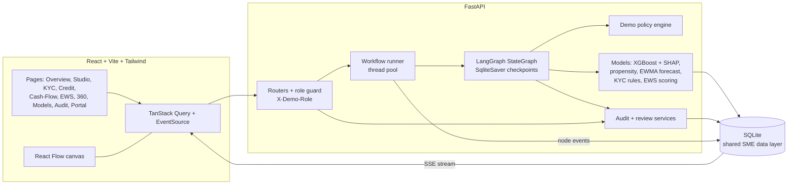
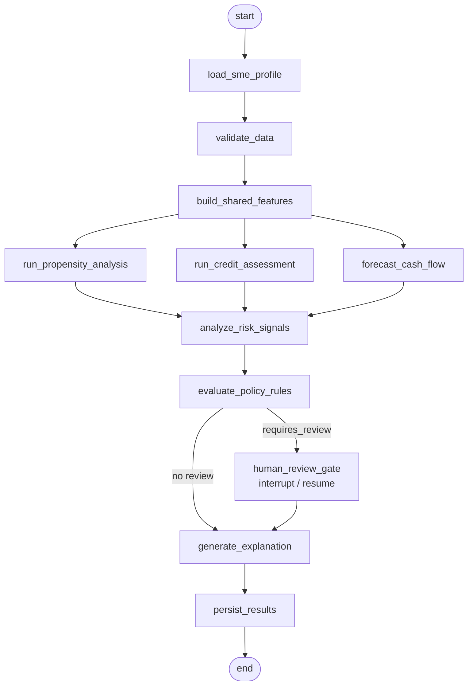

# SMEFlow Intelligence

An AI-powered SME banking prototype that walks one customer journey end to end:
**Discover → Onboard → Assess credit → Forecast cash flow → Monitor risk → Retain and grow.**

The centrepiece is a real **LangGraph** pipeline. You can run it, watch each node execute live (events are
persisted and streamed over SSE, not animated on a timer), pause at human-review gates, and inspect every
node's input, output and metrics.

> **This is a prototype on synthetic data.** All 40 SMEs, bank statements, bureau scores and documents are
> generated. External checks (GST, PAN, Aadhaar, bureau, e-sign) are **simulated placeholders** and are labelled
> as such in the UI. Policy outcomes are demo policy results, not bank credit decisions.

## Quick start

Requirements: Python 3.11+, Node 20+.

```bash
# 1. Backend  (terminal 1)
cd backend
python -m venv .venv && source .venv/bin/activate     # Windows: .venv\Scripts\activate
pip install -r requirements.txt
cp ../.env.example ../.env                             # optional - works without it
uvicorn app.main:app --port 8000                       # seeds 40 SMEs and runs 5 real workflows on first start

# 2. Frontend  (terminal 2)
cd frontend
npm install
npm run dev                                            # http://localhost:5173  (proxies /api to :8000)
```

No API key is needed. To point the dev server at a different backend: `VITE_API_PROXY=http://host:port npm run dev`.

Production-style frontend: `npm run build && npm run preview` (http://localhost:4173).

### Reseed / reset

Settings → **Reset demo data**, or from the shell: `cd backend && python -m app.db.seed`.

## Try it in two minutes

1. Open **AI Workflow Studio**.
2. Click **Scenario A** (healthy SME, full lifecycle). Nodes light up in order as real events arrive; click a node to see its input, output and metrics.
3. Click **Scenario B** (liquidity stress). The run pauses at **Human review gate**. Switch role (top right) to *Credit Analyst*, read the evidence and record a decision with a reason. The run resumes from its checkpoint.
4. Click **Scenario C** (KYC exception). Switch to *KYC Analyst* to decide; other roles see the item but cannot decide it.
5. Visit **Audit & Governance** to see every step, decision and reveal in the trail.

| Scenario | SME | Template | What happens |
|---|---|---|---|
| A – healthy | SME-1001 | full lifecycle | Runs through with no review gate |
| B – liquidity stress | SME-1006 | full lifecycle | Policy refers; shortfall within the review window; human review |
| C – KYC exception | SME-1004 | KYC onboarding | Document exceptions; KYC Analyst review |

## Architecture



### The pipeline



The gate runs only when the policy engine sets `requires_review`; otherwise the edge skips it. The exact node list and the five templates (full lifecycle, prospecting, KYC onboarding, credit assessment,
cash-flow & EWS) come from `GET /api/workflows/templates` and `/graph`, so the canvas always reflects the backend.

### Data flow

- Every node is wrapped by `traced()`, which writes a `WorkflowNodeEvent` row (started / completed / failed / interrupted / resumed).
- `GET /api/workflows/runs/{id}/stream` replays persisted events then follows new ones (supports `after` and `Last-Event-ID`). The UI falls back to polling if SSE is unavailable.
- Human review uses LangGraph `interrupt()`; the decision endpoint resumes the run with `Command(resume=...)` from the SQLite checkpoint. Nothing is ever auto-approved.
- Cancel is cooperative; retry creates a new run linked by `retry_of`; runs left `running` after a restart are marked failed on startup.

## What is real and what is simulated

| Area | Status |
|---|---|
| LangGraph orchestration, checkpoints, interrupts, events, SSE | Real |
| Credit PD model (XGBoost, SHAP explanations) | Real model trained on **synthetic** labels |
| Model metrics (AUC, KS, Brier, calibration, PSI, forecast back-test, KYC extraction accuracy) | Computed from the data; EWS shows "Not available" with a reason because no labelled outcomes exist |
| Cash-flow forecast | Transparent EWMA baseline with scenario levers; the ±1.28σ band is a heuristic, not a calibrated interval |
| Propensity | One-vs-rest logistic model, uncalibrated |
| KYC | Rule-based (Verhoeff, GSTIN, PAN checks); only the last 4 Aadhaar digits are stored; OCR needs Tesseract, otherwise text/sample documents are used |
| External verification (GST, PAN, Aadhaar, bureau, e-sign) | **Simulated** placeholders, always labelled |
| Policy engine | Configurable demo rules (KYC-001, CRD-001..007, DATA-001, FCST-001, EWS-001, CON-001) |
| Roles | Demo RBAC via `X-Demo-Role` header – a prototype convention, **not authentication** |

## Roles

Relationship Manager, Credit Analyst, KYC Analyst, Risk Manager, SME Customer (portal only).
KYC exceptions are decided by KYC Analysts; credit referrals by Credit Analysts / Risk Managers; risk escalations by RM / Credit Analyst / Risk Manager.
Decisions require a written reason (10+ characters; 25+ to approve over blocking KYC exceptions). PAN/GSTIN are masked and can be revealed only by KYC/Credit Analysts, with an audit entry.

## Configuration

| Variable | Default | Purpose |
|---|---|---|
| `LLM_PROVIDER` | `none` | `none`, `anthropic` or `openai`. Optional polish of explanations; the deterministic text is always produced first |
| `ANTHROPIC_API_KEY` / `OPENAI_API_KEY` | empty | Only read from the environment; never stored or logged |
| `LLM_MODEL` | empty | Optional model override |
| `DEMO_STEP_DELAY_MS` | `450` | Pacing so live runs are watchable; `0` disables |
| `DEMO_AS_OF_DATE` | today | Anchor date for synthetic data |
| `BOOTSTRAP_WORKFLOWS` | `true` | Run five real workflows on first seed |
| `DATABASE_URL` | SQLite in `data/` | Any SQLAlchemy URL |
| `CHECKPOINT_DB_PATH` | SQLite in `data/` | LangGraph checkpoint store |

## Tests

```bash
cd backend && source .venv/bin/activate && pip install -r requirements-dev.txt
python -m pytest app/tests -q          # workflows, scenarios A/B/C, resume, fault injection, RBAC, masking, modules

cd frontend
npm test                               # Vitest: run-state derivation, formatters, components, role gating
npm run typecheck && npm run build
```

Fault injection (`FAULTS`) is a labelled test option used to exercise failed-node and retry paths.

## Repository layout

```
backend/app/
  api/          FastAPI routers, role guard
  graphs/       LangGraph state, nodes, builder, execution events
  ml/           KYC, features, credit, propensity, forecast, EWS, training data
  services/     workflow runner, policy, review, audit, evaluation, dashboards, KYC service
  db/           session, synthetic data, seed
  tests/        pytest suite
frontend/src/
  pages/        one file per page
  components/   shell, primitives, charts, review panel
  lib/          api client, SSE hook, run-state derivation, roles, formatters
```

## Known limitations

- Synthetic data only; model quality figures describe the synthetic world, not a real portfolio.
- External verification is simulated.
- A run can pause only at the human review gate, not mid-node.
- Credit utilization history is simulated.
- The forecast back-test reports zero recall on shock-start stress personas; this is expected for a baseline that has no forward-looking signal, and the UI says so.
- Brand colours follow the supplied palette; two functional tokens outside it are used for status – risk red `#b23a48` and warning orange `#c7791a`.
- Instrument Sans loads from Google Fonts; offline, the UI falls back to the system font.
